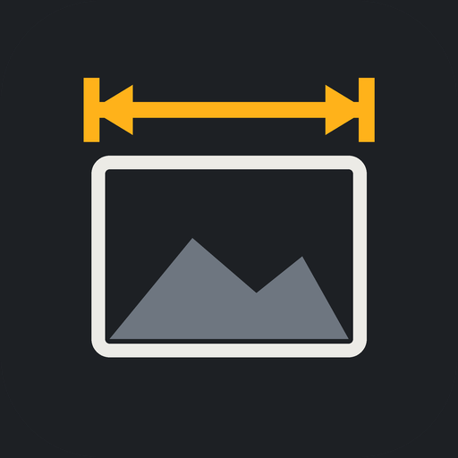

  

<h1 align="center">MedLoM</h1>

  Anota medidas sobre tus fotos: cotas con flechas, textos y dibujos, organizadas por proyectos. 
  <a href="https://lorenzo2t2.github.io/medlom/"><b>Abrir la app</b></a> ·
  <a href="https://lorenzo2t2.github.io/medlom/privacidad.html">Política de privacidad</a>

---

## Qué es

MedLoM es una app para tomar medidas sobre fotografías. Haces una foto (o eliges una de la galería), dibujas cotas encima con su medida real y la compartes como imagen o PDF. Funciona en **Android**, **iPhone** y **PC**, y se sincroniza entre todos ellos con tu propio **Google Drive**.

Esta carpeta contiene la versión web de la app, publicada con GitHub Pages en **https://lorenzo2t2.github.io/medlom/**.

## Funciones

**Medir**
- Cotas con flechas y varios estilos de remate (flecha, flecha abierta, trazo oblicuo, punto…) y de texto (encima, en la línea o en etiqueta).
- Lupa para colocar cada extremo con precisión.
- **Medida de referencia:** marcas una medida real y las demás se calculan solas con la escala.
- **Plano de perspectiva:** corrige las medidas de fotos hechas en ángulo.
- Cotas en cadena, áreas, ángulos, rectángulos y círculos con ancho, alto, diámetro, radio y área.
- Lápiz que convierte la escritura a mano en texto o en medida (Android).
- Compatible con medidores láser Bluetooth: Leica DISTO, Bosch GLM y otros mediante un modo de aprendizaje (Android).

**Legibilidad automática**
- **Color automático:** cada medida toma el color que mejor se lee sobre la parte de la foto que tiene debajo.
- Los números se apartan solos de otras líneas y textos y, si no caben, se reducen un poco.
- Las cotas que se cruzan dejan un **hueco** en la línea de debajo, y también alrededor de los números (tamaño ajustable).
- Sombra de textos y cotas con grosor y color configurables.

**Organizar y compartir**
- Proyectos para agrupar fotos, con cliente, dirección y notas.
- Exportar una o varias fotos o proyectos como **PDF** o **JPG**, con medidas o como **foto original sin medidas**.
- PDF personalizable: portada, logotipo, cabecera, pie, tabla de medidas y opción de empezar las fotos en la primera página.
- Tabla de medidas en CSV para Excel.
- Compartir directamente por WhatsApp, correo, etc.

**Sincronización**
- Google Drive en Android, iPhone y PC: carpeta `MedLoM` en tu Drive, con las fotos ya anotadas en una subcarpeta por proyecto.
- Jottacloud y OneDrive (Android).
- Copia de seguridad completa en ZIP.

## Instalación

### iPhone
1. Abre **https://lorenzo2t2.github.io/medlom/** en **Safari**.
2. Pulsa **Compartir › Añadir a pantalla de inicio**.
3. Abre MedLoM desde el icono nuevo.

### PC (Windows, Mac o Linux)
1. Abre **https://lorenzo2t2.github.io/medlom/** en **Chrome** o **Edge**.
2. Pulsa el icono de instalar de la barra de direcciones (o menú › *Instalar MedLoM*).
3. Se abre en su propia ventana, como una app más.

### Android
Instala el archivo `MedLoM-x.xx.apk` (hay que permitir *instalar apps de origen desconocido*). La versión de Android incluye funciones que la web no tiene: cámara directa, lápiz, láser Bluetooth, Jottacloud y OneDrive.

## Dónde se guardan los datos

| | Fotos y medidas | Lo que exportas y guardas |
|---|---|---|
| **Android** | Zona privada de la app | `Documentos/MedLoM` |
| **PC** (Chrome/Edge) | Almacenamiento del navegador | La carpeta que elijas (normalmente `Documentos/MedLoM`) |
| **iPhone** | Almacenamiento de Safari | Donde elijas con *Guardar en Archivos* |

MedLoM no tiene servidores propios: tus fotos solo salen del dispositivo si activas Google Drive (u otra nube), y entonces van a **tu** cuenta. El permiso de Drive (`drive.file`) solo da acceso a los archivos que crea la propia app. Más detalles en la [política de privacidad](https://lorenzo2t2.github.io/medlom/privacidad.html).

## Actualizar la versión web

1. Descomprime el `MedLoM-iPhone-web.zip` de la nueva versión.
2. Sube **todos** sus archivos a la raíz de este repositorio, sustituyendo los anteriores.
3. En unos minutos GitHub Pages publica la nueva versión. En el iPhone o el PC, cierra y vuelve a abrir la app para que se actualice.

## Contenido del repositorio

| Archivo | Para qué sirve |
|---|---|
| `index.html` | La app completa |
| `sw.js` | Permite usarla sin conexión y la actualiza |
| `manifest.webmanifest`, `icon-*.png` | Nombre e iconos para instalarla |
| `jspdf.umd.min.js`, `jszip.min.js` | Creación de PDF y copias de seguridad |
| `*.woff2` | Tipos de letra |
| `privacidad.html` | Política de privacidad |
| `.nojekyll` | Indica a GitHub Pages que publique los archivos tal cual |

---

MedLoM · App para anotar medidas sobre fotografías

